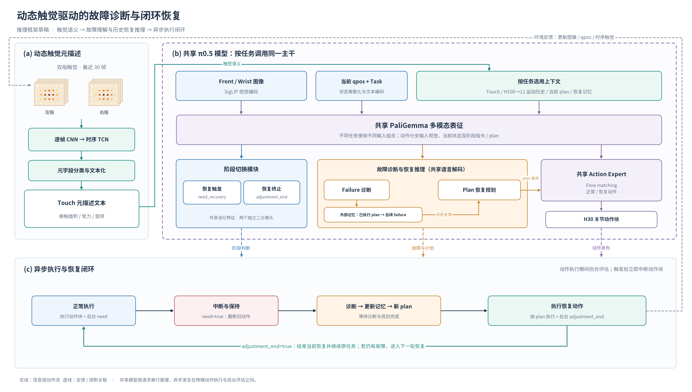

# 模型推理框架图：构思与草稿说明



图按三个核心贡献组织，整体采用“上部模型信息流、下部在线运行闭环”的布局。先讲触觉如何形成语义，再讲模型如何理解故障并给出恢复策略，最后讲策略如何在机器人执行中构成闭环。

## 三块区域

**(a) 动态触觉元描述。** 左侧画双指连续触觉窗口，经逐帧 CNN、时序 TCN、元字段分类输出 Touch 文本。小网格仅为接触信号示意，不代表真实测量。草稿不展开具体字段数量，便于后续采用论文版五字段定义。

**(b) 共享模型推理。** 上部为图像、当前状态和任务，以及按任务选择的上下文；中间为共享 PaliGemma 表征；下部分为阶段切换、语言推理和动作生成三个功能出口。虚线外框表示同一 π0.5 模型，不表示这些任务在服务器上同时推理。

- 阶段切换统一画成一个模块，内部保留 need_recovery 和 adjustment_end 两个独立头。
- 故障诊断和恢复规划共享语言解码参数，按先后顺序调用。failure 与此前已执行的 plan 配对后更新外部记忆，再用于新 plan 推理；记忆是程序维护的文本记录，不是新增的神经网络记忆模块。
- 正常动作与恢复动作共享 Action Expert，plan 作为恢复动作生成的条件，不通过固定规则直接转换为动作。
- Touch、运动历史和恢复记忆按任务选择。action 不直接使用 Touch 或 H100；need/failure/end 使用 Touch 和 H100；plan 使用 Touch 和恢复记忆，不使用 H100。

**(c) 异步闭环运行。** 正常动作执行期间后台判断 need；触发后立即中断并保持，完成 failure、记忆更新及 plan 推理，再执行恢复动作。恢复阶段后台判断 adjustment_end；触发后返回正常执行。若之后仍检测到故障，再进入下一轮恢复。false 判断意味着继续当前阶段，图中省略重复自环以保持简洁。

## 论文图中保留的重点

1. **触觉文本是故障理解的语义桥梁。** 用绿色支路从触觉描述器连到模型上下文。
2. **恢复策略考虑已执行操作的后续反馈。** 显式画出“已执行 plan → 后续 failure → 更新记忆 → 新 plan”。第一项计划记为 initial plan，不应将刚生成、尚未执行的计划立即与当前 failure 配对。
3. **监测与物理执行异步。** 下方闭环标出动作块内中断与阶段切换；模型服务端实际按请求串行推理。图中没有宣称无停顿执行或多个模型并行计算。

恢复结束头判断的是当前恢复操作是否结束，不代表整个任务已经成功。当前运行逻辑是恢复结束后回到 execution，再检测残余故障；不画成 adjustment 内直接反复重规划。

## 建议图注

**动态触觉驱动的故障诊断与闭环恢复框架。** 时序触觉描述器将双指接触信号转换为离散元描述文本。共享 π0.5 模型结合视觉、触觉及任务相关上下文，完成阶段判断、故障诊断、基于历史反馈的恢复规划与动作生成。系统在动作执行期间异步评估状态，按需中断动作并进入恢复，恢复结束后继续原任务；后续故障与已执行恢复计划配对记录，支持下一轮恢复推理。

## 文件与后续修改

- [PNG 预览](模型推理框架_草稿.png)：直接查看与讨论布局。
- [SVG 矢量稿](模型推理框架_草稿.svg)：保留文本和图形对象，便于编辑。
- [PDF 矢量稿](模型推理框架_草稿.pdf)：便于文档排版与缩放。
- [绘图源码](draw_inference_framework.py)：修改模块、文案与连线后重新导出三个格式。

重新生成：

```bash
python 论文准备/draw_inference_framework.py
```

正式英文稿可移除草稿标题和底部实现提示，压缩模块文字，以真实机器人画面替换左侧示意，并按论文最终实现补充 Touch、failure、plan 示例。当前草稿参考有触觉 V11.2 完整方法；V11.3 为无触觉消融，不作为主图。
