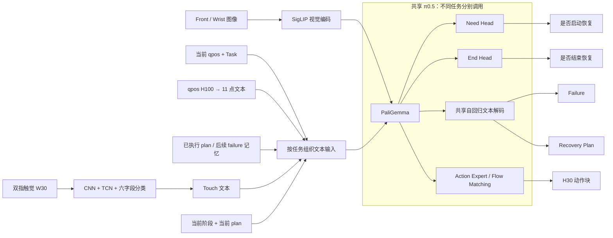
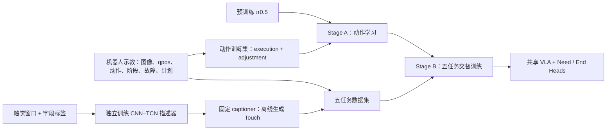
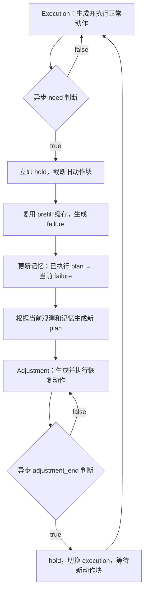

# 模型框架与训练、推理流程（框架图依据）

核对日期：2026-10-15。依据当前模型、训练、服务端和机器人端代码，并读取 Bottle 训练产物的 `config.json` 核对实际配置。

**整体方法：独立的时序触觉描述器将双指触觉转为文本；共享的 π0.5 模型完成动作生成、状态判断、故障诊断和恢复规划；异步控制程序根据判断结果切换执行与恢复阶段，并维护恢复历史。**

最新编号 **V11.3 是无触觉输入消融**；完整触觉方法对应 **V11.2**。下文以 V11.2 为主，说明 V11.3 的区别。这里总结的是当前 Bottle 实现，不将其他任务的数据策略或论文拟采用的字段混入当前实现。

## 一、模型框架

### 1. 时序触觉描述器：原始信号 → 离散标签 → Touch 文本

输入为最近 **30 帧双指触觉网格**。每个手指提供三维力、网格位置及网格运动信息，空间大小为 `35×20`：

| 输入 | 双指拼接后的通道数 | 网络输入形状 |
| --- | ---: | --- |
| `mesh_motion`：左右网格位置与运动 | 12 | `B×30×12×35×20` |
| `force`：左右三轴力网格 | 6 | `B×30×6×35×20` |

两路沿通道维拼成 18 通道。每帧经过共享 CNN 空间编码，再用时序卷积网络聚合窗口内的接触变化，取末时刻特征，通过六个分类头分别预测标签，最后按固定模板组成 Touch 文本。

```text
双指触觉窗口 → 通道拼接 → 逐帧 CNN → 时序卷积 TCN → 六个分类头 → Touch 文本
```

模型默认配置为：CNN 输出 128 维，时序隐藏维度 192，四个残差时序块的 dilation 为 1、2、4、8。实际配置由 captioner checkpoint 加载。输入只使用当前及过去的窗口；不要将内部对称 padding 的 TCN 直接标成“因果卷积”。

当前部署使用 V4 六字段：`area / Fx / Fy / Fz / Fz_bias / rotation`。这一步是**多字段分类与模板文本化**，没有用语言模型自由生成触觉描述。

### 2. 共享 VLA：一套主干，五项任务

主体基于 OpenPI 的 **π0.5**：图像经过 SigLIP 视觉编码器，文本及离散化的当前机器人状态进入 PaliGemma；动作专家通过 flow matching 生成动作块。当前使用 `gemma_2b_lora` 和 `gemma_300m_lora` 两个配置。

| 功能 | 实现方式 | 输出 |
| --- | --- | --- |
| 动作生成 `action` | Action Expert，条件 flow matching | 未来 30 步动作 |
| 恢复触发 `need_recovery` | PaliGemma 有效前缀特征均值池化 + 独立 MLP 二分类头 | false / true |
| 故障诊断 `failure` | 共享 PaliGemma 自回归解码，带文本语法约束 | failure 文本 |
| 恢复规划 `plan` | 同一 PaliGemma 自回归解码，使用另一任务输入和语法 | recovery plan 文本 |
| 恢复结束 `adjustment_end` | 相同池化方式 + 另一个独立 MLP 二分类头 | false / true |

**故障诊断与恢复规划共享语言模型参数；正常执行与恢复动作也共享动作专家。** 画图可按功能画多个出口，但应把它们包在“共享 VLA”框内。failure 和 plan 不能画成两套独立大模型，也不能画成与 captioner 相同的逐字段分类头。

动作模型内部输出为 `30×32`，有效机器人动作取 7 维，即六个臂关节与夹爪开合。训练使用相对于当前状态的 delta action，推理后进行反归一化并恢复为绝对关节目标，再发布到机器人。plan 是动作生成的语言条件，不是通过硬编码解析器直接换算成固定关节增量。

### 3. 五项任务的输入不同

以下各任务都使用 front/wrist 两路当前图像、当前 7 维 qpos 和任务指令。当前 qpos 归一化后按 π0.5 协议进入离散 State 文本前缀。

| 任务 | Touch | 额外文本条件 | qpos 历史 H100→11 | 恢复历史 |
| --- | --- | --- | --- | --- |
| 正常动作 | 无 | `Mode: execution` | 无 | 无 |
| 恢复动作 | 无 | `Mode: adjustment` + 当前 plan | 无 | 无 |
| need / failure | 有 | phase prompt + 当前 plan，无计划时为 none | 有 | 无完整配对历史 |
| adjustment_end | 有 | phase prompt + 当前 plan | 有 | 无完整配对历史 |
| plan | 有 | 当前故障及 failure–plan 记忆 | 无 | 1–4 对 |

因此，触觉通过**状态判断、故障诊断、恢复规划和阶段切换**影响动作。当前 action 分支没有直接输入 Touch，也没有原始触觉特征输入。

需在图中区分三种时间信息：

- **触觉窗口 W30**：连续触觉网格，进入 CNN–TCN。
- **运动历史 H100→11**：最近 100 个 qpos 采样点，均匀取 11 点，离散为 `11×7` 数值文本，进入状态评估与诊断。在线采用原始 30 Hz 历史，约覆盖 3.3 秒，包括当前时刻；不足时用 episode 首帧左补。它不是连续历史 GRU 分支，当前配置 `use_state_history=false`。
- **恢复历史 M**：已执行 plan 及其后续 failure 的文本配对，进入 plan 推理。

### 4. 模型结构图草稿



图中“按任务组织文本输入”是输入选择，不是额外学习模块；具体连线遵循上一表，不能理解为所有任务都输入所有信息。failure 写入记忆后用于下一次 plan 调用，plan 再进入恢复动作与状态评估的条件。

## 二、训练流程

### 1. 独立训练触觉描述器

触觉窗口配合字段标签训练 CNN、TCN 和分类头。采用 **masked 多字段交叉熵**：仅对有标注的字段计算损失，无标注字段不参与监督。训练得到的 captioner 用于离线标注机器人轨迹，并在有触觉部署时在线生成同格式描述。

captioner 与 VLA **分开训练**。VLA 训练读取已有 caption 文本，梯度不会通过离散文本回传到 captioner。

### 2. Stage A：学习正常执行和恢复动作

从预训练 `pi05_base` 初始化，使用正常执行及恢复示教训练动作生成。两种阶段通过不同指令区分，恢复示教还提供 plan。输入没有 Touch，也没有连续 qpos 历史。

监督目标为 H30 动作块，采用 flow matching：将真实动作与高斯噪声插值，模型预测流场速度，以预测速度和目标速度的均方误差训练。

Stage A 使用主干与动作专家的 LoRA 配置。**严格按当前冻结过滤器，不能将这一阶段简单标为“仅 LoRA 参数训练”**：`get_freeze_filter()` 冻结的是 LLM 内非 LoRA 参数，视觉编码器及动作输入/输出投影等 LLM 之外的参数仍落在可训练集合中。`train_lora_only=true` 的参数名并不等于全模型只更新 LoRA。若框架图标注冻结区域，应按这一实际范围绘制。

V11.2 对恢复示教中的“夹爪满开后至首次旋转前的冗余等待”作离线压缩，保留到位后 5 帧稳定时间，用实际保留帧组成 H30；正常执行轨迹不压缩。该操作属于训练数据处理。

实际 Bottle Stage A 保存配置为 **7500 次更新、batch 16**，学习率在第 3500 次更新后由 `5e-5` 切换到 `5e-7`。这是实际 run 配置，区别于入口的 15000 步、batch 8 默认值。

### 3. Stage B：共享主干的五任务交替训练

加载 Stage A 的 `/7500` checkpoint，加入 need 和 end 两个分类头，按以下顺序轮换更新：

```text
action → adjustment_end → need_recovery → failure → plan → 下一轮
```

| 训练任务 | 监督目标 | 损失 |
| --- | --- | --- |
| action | 正常或恢复示教 H30 | Flow-matching MSE |
| adjustment_end | 是否到达恢复结束区域 | 二分类交叉熵 |
| need_recovery | 是否需要恢复 | 二分类交叉熵 |
| failure | 故障描述文本 | 语法约束下的自回归 token 交叉熵 |
| plan | 恢复计划文本 | 语法约束下的自回归 token 交叉熵 |

文本训练使用 teacher forcing，损失仅施加于有效目标 token；合法 token mask 限制当前前缀可接续的内容。当前 Bottle grammar 支持 179 种 failure 和 636 种非空 plan，这表示允许的输出组合，不能视为训练数据覆盖了相同数量的故障与策略。

Stage B **只更新共享 PaliGemma LoRA 和两个分类头**，冻结动作专家、视觉编码器及其他参数。动作专家冻结后仍保留 action 训练任务，动作损失可以经动作专家回传到共享前缀的 LoRA，约束共享表征变化对动作能力的影响。

实际配置为总计 2000 次更新、每任务 400 次、global batch 8，各任务损失权重为 1。每个 action batch 包含 4 条恢复动作与 4 条正常执行动作。这里是**每步训练一个任务**，不要画成每条样本同时计算五项损失。

训练数据分别来自轨迹及其阶段边界、故障标注、恢复示教计划和离线 Touch。当前 Bottle 的 L1–4 训练记忆通过重复同一真实故障与相邻恢复计划构造文本前缀，目标计划不随长度改变；在线记忆则记录真实模型输出。因此，当前 Bottle 数据支持历史接口训练，但不能单凭它证明“同故障、不同历史导致不同恢复幅度”。

### 4. 训练流程图草稿



正式训练图可在 Stage B 内标记：PaliGemma LoRA、Need/End Heads 为可训练；视觉编码器、Action Expert 和其他参数为冻结。captioner 的独立监督用另一条训练支路表示。

## 三、在线推理与闭环控制

### 1. 正常执行

机器人采集 front/wrist 图像和 qpos，调用 action 分支得到 H30 动作块，按控制频率逐步发布。在动作块执行期间，后台采集新的观测、生成 Touch、整理 H100→11，调用 need 判断。

need 为 false 时继续执行；为 true 时，服务端先返回触发事件，机器人立即 hold 并截断当前动作块，再等待故障文本与恢复计划。

need 与 failure 使用**同一观测和同一前缀**：一次 PaliGemma prefill 同时得到分类特征及文本生成缓存。只有 need 为 true 才继续利用该缓存解码 failure。这样，停止动作无需等待完整 failure 和 plan 输出。

### 2. 诊断与恢复规划

得到当前 failure 后，将“此前已执行的 plan → 此次 failure”追加到记忆。首次故障的前项为 `initial plan`。记忆最多保留 4 对：最初一对加最近三对。

plan 分支使用当前图像、qpos、Touch 和更新后的记忆，自回归生成新的恢复计划。这是独立于 need/failure prefill 的一次模型调用。生成完成后，系统切换至 `adjustment`，以该 plan 为动作条件；取得新阶段的有效动作块后解除 hold。

### 3. 恢复执行、结束与再次恢复

恢复阶段仍调用同一个 action 分支，后台改用 adjustment_end 判断恢复动作是否结束。false 时继续执行当前 plan；true 时立即 hold，截断旧动作块，返回 `execution` 并重新生成正常执行动作。

**当前代码中，恢复阶段不会直接调用 need/failure/plan 重新规划。** 多轮恢复的实际路径为：

```text
正常执行 → 发现故障 → 诊断与计划 → 恢复动作
        → 恢复结束 → 返回正常执行 → 再次发现故障 → 更新记忆并生成下一计划
```

因此，adjustment_end 表示当前恢复阶段结束，不等于已证明原任务成功。新一轮 need 评估仍可能发现残余故障。任务成功由现有试验控制接口记录，不能把 end 分类头画成“任务完成判别器”。

### 4. 闭环状态图草稿



菱形判断在动作执行期间由后台请求完成，图中箭头表达阶段逻辑，不表示每执行一个动作都同步等待判断。

### 5. 异步部署应怎样画

建议将推理图分成“机器人动作执行”和“状态评估/推理”两条时间线：动作块执行期间，状态评估请求在后台运行；触发事件到达后立即中断，接着完成诊断、记忆更新与规划，随后启动新阶段动作。

实际客户端有两个推理工作线程和两条 WebSocket 连接，服务端只有**一个模型 worker 串行处理请求**。异步优势主要来自**机器人动作执行与状态评估重叠，以及动作块内可中断**，并不代表 action、failure、plan 在 GPU 上同时计算。新动作块的请求也存在 hold 等待，当前代码不是完全无间隙的动作生成流水线。

同一时刻最多一个 phase 请求在途；状态判断频率受推理与通信延迟限制。阶段切换时用 generation 编号使旧动作及过期判断失效，保持 hold，直到获得新阶段动作。正式论文图中可将这些控制机制简写为“异步监测与阶段切换”。

## 四、画论文图时需要区分的版本差异

| 项目 | 当前 V11.2 实现 | 论文已讨论的设计 |
| --- | --- | --- |
| Touch | 六字段，保留 Fz_bias | 五字段，Fx/Fy 增加异向类别，Fz 融合强弱差异 |
| failure | rotate、grasp、fz_bias、fy_change | grasp_position、shear、grasp_force、grasp_balance、rotate |
| plan | horizontal、vertical、rotate 三字段 | 增加 gripper_distance，共四字段 |
| 方向语义 | 使用现有 Bottle 标签 | 左指局部 Touch → 全局故障；旋转标签使用 yaw/pitch/roll 正负 |
| 历史策略证据 | Bottle 训练计划目标固定，L1–4 为合成文本前缀 | 需用同故障不同历史及真实多次恢复实验支撑策略变化 |

当前模型可以输出夹爪开合动作，但 plan 文本尚未设置独立 gripper_distance 字段。代码也未实现独立的几何坐标变换网络；若图中表达“局部触觉解释为全局故障”，应放在视觉与触觉联合推理功能中，不增加未经实现的几何变换模块。

V11.3 沿用同一 Stage A、五任务模型、标签及历史策略，**彻底删除模型输入中的 Touch**；部署时关闭 captioner 和触觉订阅，保留图像、qpos、运动历史及 failure–plan 记忆。可在消融小图中仅移除触觉描述支路。

还有一项明确的训练/部署差异：V11.2 的 adjustment_end **训练历史压缩等待帧，当前在线历史保留原始等待帧**。need/failure 在线同样使用原始 H100→11。不能在推理图里画上在线静止帧删除模块。

建议最终论文框架图采用三个面板：**(a) 时序触觉元描述器；(b) 共享 VLA 的判断、诊断、规划与动作生成；(c) 异步执行—恢复闭环及历史更新。** 训练策略另用小图或方法正文说明，具体字段表放在实验设置中。

## 五、代码核对入口

| 内容 | 代码位置 |
| --- | --- |
| 触觉 CNN–TCN 与分类头 | [captioner/model.py](src/tactile_vla/captioner/model.py) |
| 触觉 masked 监督 | [captioner/training.py](src/tactile_vla/captioner/training.py) |
| 当前六字段与文本格式 | [common/labels_v4.py](src/tactile_vla/common/labels_v4.py) |
| 五任务共享模型与 Stage B 参数过滤器 | [v7_7_multitask_model.py](src/tactile_vla/vla/v7_7_multitask_model.py) |
| 文本训练、共享 prefill 与缓存解码 | [stage_b_v3_jax.py](src/tactile_vla/vla/stage_b_v3_jax.py) |
| π0.5 结构、flow matching | [pi0.py](openpi/src/openpi/models/pi0.py) |
| Stage A 实际冻结规则 | [pi0_config.py](openpi/src/openpi/models/pi0_config.py) 与 [train_vla_stage_a_openpi.py](scripts/train_vla_stage_a_openpi.py) |
| V11.2 训练入口 | [Stage A](scripts/train_vla_stage_a_bottle_v11_2.py)、[五任务训练](scripts/train_vla_multitask_bottle_v11_2.py) |
| 五任务损失与轮换更新 | [train_vla_stage_b_v3.py](scripts/train_vla_stage_b_v3.py)、[train_vla_multitask_v7_7.py](scripts/train_vla_multitask_v7_7.py) |
| 运动历史与 phase 文本 | [v7_7_phase_prompt.py](src/tactile_vla/vla/v7_7_phase_prompt.py) |
| Bottle 监督与训练记忆 | [bottle_v11_1_multitask_data.py](src/tactile_vla/vla/bottle_v11_1_multitask_data.py)、[V11.2 数据扩展](src/tactile_vla/vla/bottle_v11_2_multitask_data.py) |
| 当前 failure / plan grammar | [bottle_v11_1_grammar.py](src/tactile_vla/vla/bottle_v11_1_grammar.py) |
| V11.2 服务端及共享实现 | [V11.2 入口](scripts/serve_tactile_vla_bottle_v11_2.py)、[Bottle 服务端](scripts/serve_tactile_vla_bottle_v11_1.py)、[流式判断](scripts/serve_tactile_vla_v7_7.py) |
| V11.2 客户端及共享主循环 | [V11.2 入口](openpi/inference/agilex/inference/agilex_inference_bottle_v11_2_asyn.py)、[Bottle 异步主循环](openpi/inference/agilex/inference/agilex_inference_bottle_v11_1_asyn.py) |
| 阶段切换、旧结果失效 | [v7_7_async_state.py](src/tactile_vla/vla/v7_7_async_state.py) |
| V11.3 无触觉消融 | [输入协议](src/tactile_vla/vla/bottle_v11_3_prompts.py)、[训练入口](scripts/train_vla_multitask_bottle_v11_3.py) |

以上为静态代码及保存配置核对，不代表本次重新训练或真机验证。
